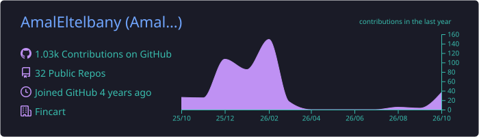
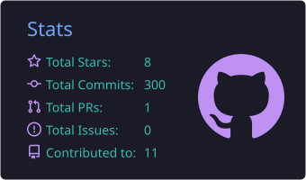
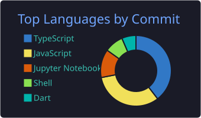

 

---

### 👩‍💻 About me

I'm a full-stack engineer who enjoys building backend systems that stay reliable under load, and clean, simple interfaces on top of them.

- 💼 **Full-Stack Software Engineer @ Fincart**
- ⚙️ **Backend:** Node.js, NestJS, REST APIs, background jobs, queues, database design and performance
- 🎨 **Frontend:** React, Next.js and TypeScript, with a focus on clean UX and Arabic/English **RTL** support
- 🌱 **Currently learning:** AI engineering, including LLM agents, RAG and evals
- 🎯 **Open to** mid-level full-stack and backend roles, Cairo or remote

 

---

### 🛠️ Tech stack

 

---

### 📊 GitHub stats

---

### 💜 Let's build something together

*"First, solve the problem. Then, write the code."*

